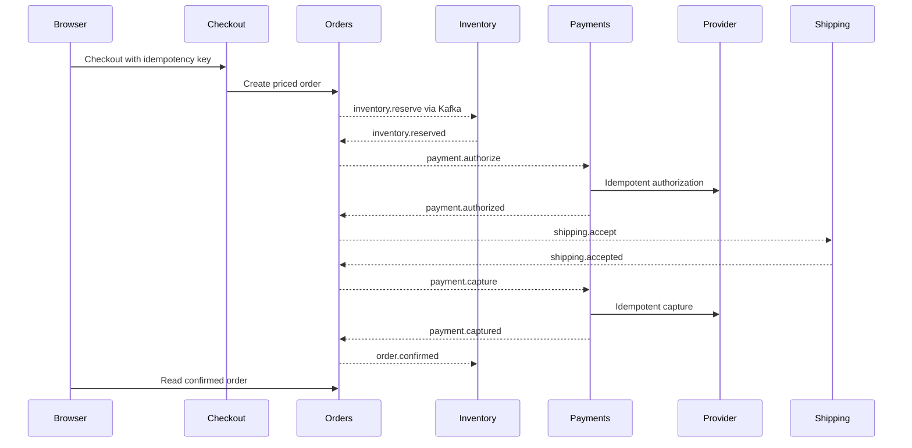

# Application architecture

## Request and purchase flow

The browser makes same-origin `/api` requests through the deployed Kong Gateway. Registration/login goes to identity. Catalog supplies products; search uses an Elasticsearch projection. Pricing always fetches current catalog prices, so browser prices are never trusted. Authenticated cart mutations go to Redis; guest carts are browser-local and merge on login.

Checkout reads the customer's server cart, requests a server quote, and creates an order using an idempotency key. It consumes the cart only if its version still matches, preserving changes made in another tab. An order stores price/address snapshots and starts in RESERVING.

Inventory reserves stock with row locks and validates all lines before reducing availability. A declined authorization releases stock. Failed fulfillment voids the authorization and releases stock. A confirmed cancellation asks shipping first, then refunds the captured payment and releases inventory; the order becomes CANCELLED only after both compensations finish. Shipping rejects cancellation once shipped. A delivered order can be returned: operator approval triggers a refund, then stock restoration and RETURNED state.

A provider timeout is an uncertain outcome, not a decline. Payments stores a stable operation ID and reconciles the provider result rather than creating another authorization. The provider simulator deliberately supports delayed/timeout outcomes to make this behavior observable.

Expired reservations request a decision from orders; orders serializes that decision against authorization/fulfillment transitions. Inventory does not release stock merely because a remote status check was stale.

## Durable event delivery

Domain changes and outbound events commit in the same database transaction. A scheduled publisher locks a per-database mutex and publishes ordered outbox records with Kafka `acks=all`. The record key is the aggregate ID. A crash between Kafka publication and marking the row can redeliver; a consumer's inbox ID and domain mutation commit together, making repeated delivery safe. This is at-least-once delivery with deduplication, not a claim of global exactly-once execution.

Each service has a separate consumer group. Retries precede a `.DLT` destination; offset acknowledgment follows successful handling or successful DLT publication. Kafka provisioning creates the topics and DLTs; operational DLT monitoring/replay remains an additional exercise. Topic partition count and replication are infrastructure settings.

| Topic | Consumers |
|---|---|
| catalog.events | search |
| inventory.commands | inventory |
| inventory.events | orders |
| payments.commands | payments |
| payments.events | orders, returns |
| shipping.commands | shipping |
| shipping.events | orders, notifications |
| orders.events | inventory, notifications, reporting |
| returns.events | orders, notifications |

Each topic also needs `<topic>.DLT` with matching partitions. Event JSON carries `eventId`, `eventType`, `schemaVersion`, `aggregateId`, `correlationId`, `causationId`, `occurredAt` and `payload`. Current schema version is 1. Topics contain customer/order information; restrict access and set retention deliberately.

## Data and trust boundaries

Identity owns password hashes/accounts. Cart owns Redis keys. Orders owns the purchase snapshot/timeline. Inventory owns stock/reservations; payments owns attempts/reconciliation; the simulator owns financial operation results. Shipping, returns and notifications own their records. Reporting and search are rebuildable projections. Common JDBC document storage supports transactions and locks; catalog additionally uses JPA/Flyway for its product table. Flyway creates schemas at application startup. A separate PostgreSQL provisioning Job creates databases/users; it does not replace Flyway. Per-service migration Jobs are not currently used.

Identity signs JWTs using a private RSA key; other services verify with the public key. Ownership checks protect customer orders/returns/notifications, and operator endpoints require OPERATOR. Internal HTTP calls require a shared token of at least 32 characters. Browser sessions are HttpOnly cookies with SameSite=Strict and secure cookies by default; unsafe cookie requests validate Origin. Kong terminates browser TLS; the checked-in charts provide workload NetworkPolicies and verified datastore client configuration, with Redis currently password-authenticated without TLS.

## Telemetry and deployment boundaries

Services expose `/actuator/prometheus`, `/actuator/health/liveness` and `/actuator/health/readiness`; readiness currently includes database connectivity. It does not guarantee Kafka, Redis or Elasticsearch health. Structured JSON logs go to stdout. Micrometer provides HTTP/Kafka observations and OTLP trace export. The deployed platform uses Prometheus, Fluent Bit/Loki, OpenTelemetry Collector/Tempo and Grafana; see the [observability handbook](handbook/04-observability.md).

The maintenance worker runs through initially suspended CronJobs. HTTP services use Deployments; stateful dependencies use StatefulSets/PVCs. The repository now includes ServiceAccounts, ExternalSecrets, ConfigMaps, certificates, Gateway routes, PDBs, HPAs and NetworkPolicies. VPA remains optional/disabled. The application does not call the Kubernetes API. See the [complete handbook](handbook/README.md) for each resource and service.
