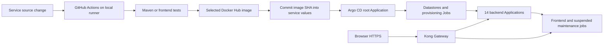

# Local deployment activation runbook

For the complete beginner-oriented setup, file explanations, service walkthroughs and incident commands, use the [end-to-end handbook](handbook/README.md). This shorter runbook focuses on delivery activation.

Current baseline verified 2026-10-24: all 23 Applications Synced/Healthy; backend Deployment/HPA cap one; 384Mi backend memory limits; zero-surge rollouts. The complete deployed shopping journey is pending user acceptance testing.

The application delivery files are now prepared for all 14 HTTP backends, the frontend, maintenance jobs, PostgreSQL, Redis, three-node Kafka, Kafka UI and Elasticsearch. The existing platform (Cilium, metrics-server, Kong/Gateway API, cert-manager, OpenBao/ESO, Prometheus/Grafana/Loki/Tempo/Fluent Bit/OTel) remains in place.

This runbook activates the prepared configuration. No GitHub secrets, runner registration, image publication or live application deployment was performed by editing these files.

## Ownership and flow



GitHub Actions builds and publishes images; Argo CD reconciles Kubernetes resources. Do not add a second helm upgrade deployment job to the application workflow. Argo uses Helm to render resources, so these Applications will not appear as Helm CLI releases in helm list.

Only affected services are built for ordinary source changes. Shared Java changes rebuild dependent backend images. Infrastructure-only changes validate charts without rebuilding every application. Dockerfiles now compile only their own Maven module and its dependencies.

## 1. Prepare GitHub before pushing workflows

Follow [CI and GitOps](ci-gitops.md):

- Create GitHub Environment learning.
- Add Environment secrets DOCKERHUB_USERNAME and DOCKERHUB_TOKEN.
- Register the local Linux x64 self-hosted runner with custom label brokecart.
- Install its required Java 17, Docker/BuildKit, Python/PyYAML, Helm and Git tools. The frontend job sets up Node.js 22 automatically.
- Allow the image-promotion job to write repository contents; protected branch rules must permit the chosen promotion flow.
- Use public Docker Hub application repositories. Private repositories need pull credentials, which this configuration does not provision.

Keep the runner outside this Git repository. One runner processes one job at a time; the workflow matrix allows at most two simultaneous builds if two runners are available. The CI job does not need an administrator kubeconfig.

Review the complete working tree before committing. The first push adding the build workflow selects all images; later source changes are selective. A manually dispatched all run is also supported.

## 2. Refresh the application security access

The application security script now adds the maintenance worker's token-only role:

```bash
bash infra/bootstrap/run-application-security-bootstrap.sh
```

Enter the OpenBao bootstrap token at the hidden prompt. Existing signing keys and internal token are preserved.

Database, Redis, Kafka and Elasticsearch bootstrap scripts from earlier steps must already have run. Their policies must match the exact ServiceAccounts/namespaces in the values files. OpenBao must be unsealed. Bootstrap tokens never belong in routine GitHub application jobs.

## 3. Validate, commit and publish images

```bash
python3 scripts/ci/validate_infra.py --dependencies
python3 scripts/preflight.py --allow-pending-images
git diff --check
git status --short
```

The allow-pending-images flag is for reviewing configuration before CI has published images. It is not deployment readiness.

Commit and push the reviewed source/configuration changes, then watch the GitHub Actions run. All selected builds must pass before the promotion job records their repository and full commit-SHA tags in infra/values/*.yaml.

After the promotion commit:

```bash
git pull --ff-only
python3 scripts/preflight.py
```

This check rejects pending-ci and placeholder Docker Hub owners. It verifies file configuration, not registry availability or business behavior.

## 4. Install Argo CD with the required health customizations

Argo CD is a platform component, installed once. The chart version below was retrieved and rendered successfully while preparing this configuration.

The application controller has a 512Mi memory request, a 2Gi limit and a `GOMEMLIMIT` of 1536MiB. Its status and operation processor counts are reduced to five and two to limit concurrent work on this local cluster. The earlier 768Mi limit caused repeated OOM kills while syncing the backend Applications, leaving their new configuration unapplied. If Applications remain OutOfSync, inspect the controller's readiness, restart count and last termination reason before repeatedly triggering syncs. Apply platform values changes through this Helm release; application changes remain managed by Argo CD.

```bash
helm repo add argo https://argoproj.github.io/argo-helm
helm repo update argo

helm upgrade --install argocd argo/argo-cd \
  --version 10.10.5 \
  --kube-context kind-brokecart \
  --namespace argocd --create-namespace \
  -f infra/platform/argocd-values.yaml \
  --wait --timeout 10m

kubectl --context kind-brokecart apply -f infra/platform/argocd-route.yaml
```

Kong terminates browser HTTPS using the existing wildcard certificate. Argo's internal HTTP service is configured behind that gateway; TLS verification for OpenBao/PostgreSQL/Kafka/Elasticsearch is independent and retained.

Add argocd.brokecart.com to the Windows hosts file at 127.0.0.1 if it is not already present. Open https://argocd.brokecart.com:8443. The initial administrator password can be retrieved locally:

```bash
kubectl --context kind-brokecart -n argocd \
  get secret argocd-initial-admin-secret \
  -o jsonpath='{.data.password}' | base64 --decode
```

Change that initial login password after signing in. If the repository is private, configure Argo CD repository access before activation; this repo URL alone does not provide credentials.

## 5. Activate the complete stack

```bash
python3 scripts/preflight.py --cluster

kubectl --context kind-brokecart apply \
  -f infra/argocd/root-application.yaml

kubectl --context kind-brokecart -n argocd get applications -w
```

The root Application manages 22 child Applications:

| Wave | Applications |
|---|---|
| 0 | PostgreSQL, Redis, Kafka, Elasticsearch, observability configuration |
| 5 | Kafka UI |
| 10 | All 14 HTTP backends |
| 20 | Frontend |
| 30 | Maintenance CronJobs, initially suspended |

The Argo Application health customization waits for child sync operations and provisioning hooks, synchronized desired state and healthy workloads. Resource waves inside each chart first create ServiceAccounts, SecretStores, ExternalSecrets and certificates, followed by configuration/Services, workloads, and provisioning Jobs where applicable.

Applying child Applications individually does not enforce this cross-Application order. The root Application is the full-stack entry point. Child Applications deliberately have no cascading deletion finalizer: deleting their Application object alone does not automatically erase its workload/PVCs.

## 6. Check live behavior

Add brokecart.com and kafka.brokecart.com at 127.0.0.1 to Windows hosts if needed. Existing Grafana/OpenBao host mappings and local-root-CA trust still apply.

- Storefront: https://brokecart.com:8443
- Kafka UI: https://kafka.brokecart.com:8443
- Grafana: https://grafana.brokecart.com:8443
- Argo CD: https://argocd.brokecart.com:8443
- OpenBao: https://openbao.brokecart.com:8443

Inspect initial state:

```bash
kubectl --context kind-brokecart get pods -A
kubectl --context kind-brokecart -n brokecart-postgres get statefulsets,pvc
kubectl --context kind-brokecart -n brokecart-kafka get statefulsets,pvc
kubectl --context kind-brokecart -n brokecart-catalog get deployment,service,externalsecret,secretstore,hpa,pdb,servicemonitor
kubectl --context kind-brokecart get httproutes -A
kubectl --context kind-brokecart top nodes
```

Exercise registration, login, browsing, cart, checkout, payment simulation, order status and the return/shipping flow. Inspect Kafka records and consumer groups using the read-only UI. Validate permissions: a customer must not be able to invoke operator actions or access another customer's data.

The business operator account is not silently created by Kubernetes. The source's trusted internal operator-bootstrap endpoint and payload are documented in [configuration/API contracts](configuration.md); create a chosen operator account from a trusted internal environment after identity is available. Its password does not belong in Git.

In Grafana, open the BrokeCart dashboard, select its Prometheus/Loki/Tempo data sources, and confirm requests, JVM/Pod metrics, logs and traces. The four alerts can be inspected in Prometheus/Alertmanager. External alert receivers and database/Kafka/Redis/Elasticsearch exporter metrics are not configured by the dashboard chart.

Run each maintenance task manually once as documented in [frontend and maintenance](frontend-maintenance.md), check its result, then change the schedules' suspend values to false in Git. Argo CD will enable them.

## Limits and exercises

All kind nodes share the same 15 GiB WSL host; their displayed capacities must not be added together. Baseline backend replicas and HPA minimums/maximums are all one. Increase only selected service caps during controlled scaling exercises after checking headroom. Load tests and simultaneous scale-up can exceed local RAM; observe resources before increasing replicas.

A backend PDB with maxUnavailable=1 permits eviction of its sole replica. It does not make a single replica highly available. Kafka's PDB retains two of its three combined broker/controllers during voluntary disruptions. Replica count alone does not provide three independent physical failure domains on one host.

VPA templates are recommendation-only (Off) and disabled until a VPA controller/CRDs are installed. Automatic VPA resource changes are intentionally not combined with CPU HPA.

Application NetworkPolicies allow HTTP traffic among the named backend namespaces, Kong and monitoring ingress, DNS, and required datastore/OTel egress. Dependency ingress is restricted to the namespaces that use it. These are namespace boundaries, not per-peer identity authorization. Redis currently uses password authentication on the local cluster network without TLS; the other prepared datastore clients use verified TLS.

PVC retention is not a backup. Complete backup/restore testing, CA/key rotation exercises, real failure tests and deployment rollback checks after the baseline is running. Payment processing remains simulated.

## What has actually been verified

Helm lint/render and cross-resource tests cover all charts and service values, selective CI behavior, credential scopes, routing, autoscaling references, network policies and Argo source paths/order. The pinned Argo CD chart was rendered with its health customizations. Alert syntax passed Prometheus promtool. A real optimized catalog Docker build passed; isolated runtime checks confirmed frontend read-only operation, Java CA import and actual catalog HTTP/JVM metrics.

These checks do not prove live end-to-end deployment. That requires the runner, successful image publication and the activation/testing sequence above.
