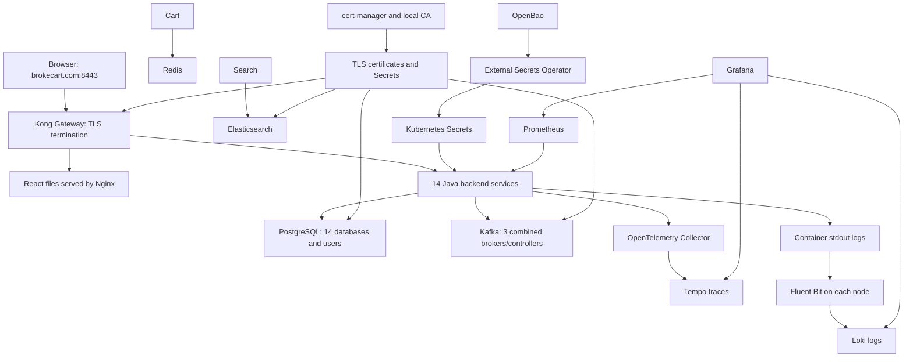

# 1. Architecture and Kubernetes basics

[Handbook index](README.md) · [Next: platform setup](02-platform.md)

## The whole system



The Prometheus arrow means Prometheus **scrapes** backend HTTP metrics. It does not mean Prometheus sends business requests into the purchase flow. Browser requests enter through Kong. Internal service calls use Kubernetes Service DNS directly and do not normally go back through public Kong routes.

There is no custom application API-gateway microservice. Kong supplies the public gateway. Kubernetes `Gateway` is configuration describing listeners; Kong's gateway Pod is the process actually handling the traffic.

## What runs where

| Namespace | Purpose |
|---|---|
| `kube-system` | CoreDNS, kube-proxy, Cilium/Envoy, Metrics Server and control-plane system Pods |
| `local-path-storage` | kind's local-path volume provisioner |
| `kong` | Kong controller, gateway, Gateway and browser TLS Secret |
| `cert-manager` | Certificate controllers and local signing CA |
| `openbao` | Secret manager and its encrypted persistent state |
| `external-secrets` | Controller that turns provider data into Kubernetes Secrets |
| `observability` | Prometheus, Grafana, Alertmanager, Loki, Fluent Bit, Tempo, OTel |
| `argocd` | Argo CD controllers/server/repository server and all Application objects |
| `brokecart-postgres`, `brokecart-redis`, `brokecart-kafka`, `brokecart-elasticsearch` | Dedicated datastore workloads |
| `brokecart-kafka-ui` | Authenticated, read-only Kafka UI |
| `brokecart-<service>` | One namespace for each of the 14 backends |
| `brokecart-frontend`, `brokecart-maintenance` | Storefront and scheduled worker resources |

An Application object in namespace `argocd` can deploy resources into `brokecart-catalog`. `metadata.namespace` identifies where the Application object lives; `spec.destination.namespace` identifies its workload namespace. Namespace separation does not automatically isolate the network—NetworkPolicy and authorization supply additional boundaries.

## Which Kubernetes resource does what?

| Resource | Simple explanation | Actual project usage |
|---|---|---|
| Node | A machine on which Pods run | Three Docker containers: control-plane and two workers |
| Pod | One scheduled unit of containers sharing networking/volumes | A Java backend, a Kafka broker, an init container plus app, etc. |
| Deployment | Keeps interchangeable application Pods running and updates them | 14 backends, frontend, platform controllers, Kafka UI |
| ReplicaSet | Deployment's Pod-count manager | Created automatically by Deployments; not authored separately |
| StatefulSet | Pods with stable ordinal names and associated storage | PostgreSQL, Redis, Kafka, Elasticsearch; upstream charts also use it |
| DaemonSet | A Pod on each matching node | Fluent Bit, node-exporter, Cilium/Envoy, kube-proxy |
| Service | Stable discovery endpoint for changing Pod IPs | Backend ClusterIP Services and datastore endpoints |
| Headless Service | DNS discovery without a virtual ClusterIP | Stable Kafka broker names and StatefulSet discovery |
| ConfigMap | Public configuration text | Peer URLs, public CA certificates, scripts, dashboards |
| Secret | Kubernetes object for sensitive data | Passwords, JWT keys, internal token, TLS keypairs |
| ServiceAccount | A workload identity for Kubernetes-aware authentication | Separate ESO login identities and application workload identities |
| Role/ClusterRole and bindings | Permission rules and assignment | ESO, Cilium, Fluent Bit, Argo controllers and OpenBao token review |
| PVC | A workload's storage request | `data-postgres-0`, `data-kafka-0`, etc. |
| PV | The actual Kubernetes storage allocation | Provisioned dynamically by local-path |
| StorageClass | How dynamic storage is provisioned | `standard`, local-path, WaitForFirstConsumer |
| Job | Runs finite work until success/failure | Database/user provisioning, Kafka topics/ACLs, ES role/index provisioning |
| CronJob | Creates Jobs on a schedule | Reservation expiry and payment reconciliation; initially suspended |
| GatewayClass | Chooses the gateway controller implementation | `kong`, handled by `konghq.com/kic-gateway-controller` |
| Gateway | Entry listeners and TLS certificate references | `kong/brokecart-gateway`, HTTP 80 and HTTPS 443 |
| HTTPRoute | Host/path-to-Service routing | `/api/catalog` to Catalog; frontend `/`; platform subdomains |
| Certificate/Issuer/ClusterIssuer | cert-manager's certificate requests and signers | Local root CA and leaf TLS certificates |
| SecretStore/ExternalSecret | ESO's provider connection and fetch instructions | OpenBao login configuration and per-service credential delivery |
| HPA | Adjusts Deployment replica count from metrics | Enabled, but locally capped at 1 minimum/maximum |
| VPA | Recommends or changes Pod resource sizing | Optional chart template; disabled, controller not assumed installed |
| PDB | Limits voluntary disruption | Backends permit one unavailable; Kafka requires two available |
| NetworkPolicy | Selects allowed Pod traffic | Backend ingress/egress and datastore ingress restrictions |
| ServiceMonitor | Prometheus Operator's scrape instruction | `/actuator/prometheus` on backend Services |
| PrometheusRule | Alert/recording expressions | Four BrokeCart alert rules |
| Application | Argo CD desired-state source and destination | One parent plus 22 children |
| CRD | Extends the Kubernetes API with another resource type | Makes `Gateway`, `ExternalSecret`, `Certificate`, `Application`, etc. recognizable |

`kubectl get all` does **not** include every one of these resources. Query Secrets, PVCs, certificates, ExternalSecrets, routes and monitoring resources explicitly.

## Request flow: opening the storefront

1. Windows hosts file resolves `brokecart.com` to `127.0.0.1`.
2. Browser connects to host port 8443; kind maps that to control-plane container port 30443.
3. Kong's proxy Service uses NodePort 30443, forwarding HTTPS to the gateway container's port 8443.
4. Kong selects the HTTPS listener and presents `brokecart-gateway-tls`.
5. Browser verifies the domain and the trusted local root CA.
6. The frontend HTTPRoute matches host `brokecart.com` and path prefix `/`.
7. Kong forwards HTTP to frontend Service port 80, then Pod port 8080.
8. Nginx returns React's compiled static files. JavaScript calls same-origin `/api/...`.
9. More specific backend HTTPRoutes send these API calls directly to the appropriate Java Service.

Nginx does not proxy application APIs itself: `frontend/nginx.conf` explicitly returns 404 for `/api/`. Kong must choose the backend route before traffic reaches frontend.

## Internal service discovery

Catalog's address is:

```text
catalog.brokecart-catalog.svc.cluster.local
```

`catalog` is the Service name, `brokecart-catalog` the namespace, `svc` the Kubernetes Service zone, and `cluster.local` the cluster DNS suffix. The backend Service exposes port 80 and targets named container port `http`, which is 8080. Thus an internal URL normally needs no `:8080`; the URL addresses the Service's port 80.

Every Java image listens on port 8080 in Kubernetes. README's 8081–8094 process ports are for running many Java processes directly on one developer machine.

```bash
kubectl --context kind-brokecart -n brokecart-catalog get service catalog -o yaml
kubectl --context kind-brokecart -n brokecart-catalog get endpointslices \
  -l kubernetes.io/service-name=catalog
```

Services select Pods by labels. Ready Pods normally appear as usable endpoints; Running but unready Pods should not receive ordinary Service traffic. Headless Kafka discovery intentionally supports broker startup/discovery needs and individual stable DNS names.

## Dependency management has several layers

1. **Parent Application waves:** datastores first, then Kafka UI, backends, frontend and maintenance.
2. **Resource waves inside a chart:** identities, provider stores, fetched Secrets/certificates, configuration, workloads, provisioning Jobs.
3. **Readiness:** determines whether a Pod can receive Service traffic. Startup protects slow initialization; liveness detects a failed process.
4. **Application behavior:** Flyway migrations, HTTP timeouts, persistent outbox retries, event consumption and compensating business actions.

Kubernetes Deployments do not have Docker Compose-style `depends_on`. A peer URL is not a readiness dependency. Backend readiness currently checks database connectivity, not every Kafka/Redis/ES operation; actual business behavior must still be tested.

## Deployment choices and laptop limits

Java services are Deployments because any healthy replica can receive requests. Their durable state belongs in PostgreSQL/Redis rather than the Pod filesystem. Kafka needs named broker identities and persistent logs, so its StatefulSet ordinals map to node IDs. Fluent Bit needs access to logs on every node, so it is a DaemonSet.

One replica is a resource-saving choice, not high availability. The three kind nodes share one physical laptop and its RAM/disk; their allocatable capacities cannot be added as independent machines. Kafka has three logical nodes but still shares a physical failure domain.

PDBs do not stop hardware failure, OOM kills or every Deployment update. A backend `maxUnavailable: 1` allows losing its only replica during voluntary eviction. The zero-surge local rollout similarly accepts a short outage while replacing a service Pod.

## What is deliberately absent

- No ZooKeeper: Kafka uses KRaft.
- No application-level API-gateway microservice; no public route to payment-provider or `/internal`.
- No installed VPA controller in the required baseline; its template is optional and disabled.
- No standalone authored ReplicaSet manifests; Deployments create them.
- No standard Ingress object for the application; we use Gateway API/HTTPRoute.
- No real payment processor, carrier, email/SMS provider or production compliance claim.
- No complete backup/restore, automatic unseal, credential-rotation or DLT replay system.

These boundaries are part of understanding the current system, not missing proof that every Kubernetes feature must be installed.
