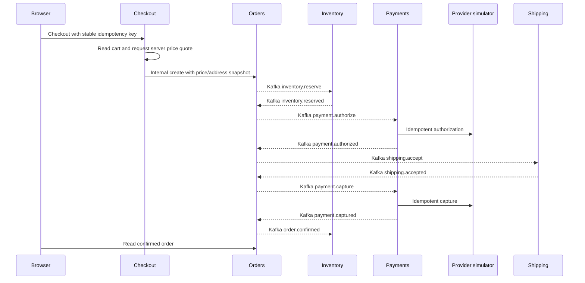

# 6. Every application service, from source to Kubernetes

[Index](README.md) · [Previous](05-data-services.md) · [Next: delivery](07-delivery.md)

## Shared resources: learn one service, then its differences

Each backend has:

- Source in `services/<name>-service/`, a Maven `pom.xml`, Dockerfile, Java controllers/domain code, application YAML and migrations.
- A values file `infra/values/<name>.yaml` selecting its image, namespace-related references, peer URLs, dependency options and public paths.
- An Argo Application `infra/argocd/applications/<name>.yaml` using shared chart `infra/charts/application` and destination `brokecart-<name>`.

The common chart renders these resources:

| Resource | Purpose and wiring |
|---|---|
| Namespace, created by Argo sync option | Keeps this service's namespaced objects together |
| Workload ServiceAccount `<name>` | Pod identity; no automatically mounted API token |
| DB login ServiceAccount `<name>-secrets` | ESO's scoped Kubernetes authentication identity |
| SecretStore `openbao` | Verified provider URL/CA plus the DB login role/account |
| ExternalSecret `<name>-database-credentials` | Reads only this service's DB path |
| ConfigMap `<name>-config` | Port, peer URLs, sampling, pool configuration and public settings |
| ConfigMap `<name>-postgres-ca` | Public CA file mounted for verified database TLS |
| Security login ServiceAccount/SecretStore/ExternalSecret | Fetches JWT public key and internal token; private key only for Identity |
| Deployment | One Ready backend Pod, read-only root, non-root UID 10001, port 8080 |
| ReplicaSet | Automatically created by the Deployment to own its Pod |
| Service `<name>` | ClusterIP port 80 to named container `http` port 8080 |
| HPA `<name>` | CPU target 70%, locally min/max one; owns replicas when enabled |
| PDB `<name>` | `maxUnavailable: 1`; permits maintenance but not single-Pod availability |
| ServiceMonitor `<name>` | Application metrics every 60s, selected by monitoring release |
| NetworkPolicy `<name>` | Namespace-scoped application HTTP ingress and required egress |
| HTTPRoute `<name>`, when public | Parent `kong/brokecart-gateway`, HTTPS, host `brokecart.com`, configured API prefixes |

Nine Kafka-using services add a Kafka login ServiceAccount, SecretStore, ExternalSecret with a templated JAAS value, and Kafka configuration/CA ConfigMap. Cart adds a Redis credential bundle. Search adds an Elasticsearch credential bundle and public Java truststore initialization. Conditional templates prevent unrelated dependency credentials being mounted everywhere.

### How the Deployment starts

1. Argo's earlier waves create accounts, valid provider stores, fetched credentials and certificates.
2. Kubernetes schedules the Pod and pulls the full-SHA-tagged Docker Hub image.
3. For Search, an init container builds a truststore before Java starts.
4. Environment variables load from ConfigMap and individual Secret keys. `DB_NAME` is defined before `DB_URL` so Kubernetes can expand `$(DB_NAME)` in the JDBC URL.
5. Java loads common configuration, starts Hikari and runs Flyway migrations against its own DB.
6. The startup probe waits for `/actuator/health/liveness`. Liveness later checks the process; readiness checks `/actuator/health/readiness` including DB connectivity.
7. Ready endpoints become available through its Service. Kafka consumers/publishers continue initializing/retrying independently.

The JVM uses `-Xms64m -Xmx192m`, Serial GC, one active processor and ExitOnOutOfMemoryError. Request is 100m CPU/192Mi memory; memory limit is 384Mi. Heap is only part of process memory. Config/CA checksums in Pod annotations trigger rollout when those public files change. Secret environment changes still need a coordinated restart.

### Commands for any one backend

Set `service` to a real name from the table below. These commands are read-only, except the local Helm render writes a temporary file:

```bash
service=catalog
helm lint infra/charts/application -f "infra/values/$service.yaml"
helm template "$service" infra/charts/application \
  --namespace "brokecart-$service" -f "infra/values/$service.yaml" \
  > "/tmp/brokecart-$service-rendered.yaml"
kubectl --context kind-brokecart -n "brokecart-$service" \
  get deployments,replicasets,pods,services,hpa,pdb
kubectl --context kind-brokecart -n "brokecart-$service" \
  get configmaps,secretstores,externalsecrets,servicemonitors,httproutes,networkpolicies
kubectl --context kind-brokecart -n "brokecart-$service" \
  logs "deployment/$service" -c application --tail=40
```

Do not use `helm get values catalog` for an Argo-rendered release; chapter 7 explains that distinction. Check `infra/values/catalog.yaml`, rendered output and live Kubernetes objects instead.

## Service directory

| Name | Database | Special dependency | Public route prefixes |
|---|---|---|---|
| catalog | catalog | Kafka producer | `/api/catalog` |
| pricing | pricing | Catalog HTTP | `/api/pricing` |
| identity | identity | Private JWT signing key | `/api/identity` |
| cart | cart | Redis, Catalog HTTP | `/api/cart` |
| checkout | checkout | Cart, Pricing, Orders HTTP | `/api/checkout` |
| orders | orders | Kafka saga orchestration | `/api/orders`, `/api/operations/orders` |
| inventory | inventory | Kafka; Orders HTTP for expiry | `/api/operations/inventory` |
| payments | payments | Kafka; provider HTTP | `/api/operations/payments` |
| payment-provider | payment_provider | Internal HTTP only | None |
| shipping | shipping | Kafka; Orders HTTP | `/api/shipping`, `/api/operations/shipping` |
| returns | returns | Kafka; Orders HTTP | `/api/returns`, `/api/operations/returns` |
| notifications | notifications | Kafka projections | `/api/notifications` |
| search | search | Kafka, ES, Catalog HTTP | `/api/search` |
| reporting | reporting | Kafka projections | `/api/operations/reports` |

All have PostgreSQL credentials even where the business workload is small. Usernames are `brokecart_<database>`. The common values map includes peer URLs for all services, but a configured URL does not prove the source actually calls that peer. The dependencies described here follow the current source.

## 1. Catalog

**Source:** `services/catalog-service`; important code includes `CatalogController`, `CatalogOperations`, product repository/entity and Flyway migration files. **Values:** `infra/values/catalog.yaml`.

Catalog owns the authoritative product list and prices in PostgreSQL. Customer browsing uses `GET /api/catalog/products` and `/{id}`. Price changes require OPERATOR and write `catalog.product_changed` to the transactional outbox, eventually published to `catalog.events` for Search.

Pricing and Cart consult Catalog over HTTP; Search also periodically reconciles its index from Catalog. Browser-supplied product prices are not trusted as purchase amounts. Catalog's Kafka credentials grant write access to its event topic, not general Kafka administration.

Learning check: compare the Service's selector to Deployment Pod labels, then compare `infra/values/catalog.yaml` with the rendered ConfigMap. An API smoke test through Kong:

```bash
curl --noproxy '*' --cacert /tmp/brokecart-root-ca.crt \
  --resolve brokecart.com:8443:127.0.0.1 \
  https://brokecart.com:8443/api/catalog/products
```

## 2. Pricing

**Source:** `services/pricing-service`; `PricingController` and quote/pricing code. **Values:** `infra/values/pricing.yaml`.

Pricing calculates quotes from current Catalog data, applies the BROKE10 discount and shipping rules, and returns integer USD cent totals. `POST /api/pricing/quotes` accepts item IDs/quantities and a promotion code. Prices are calculated on the server rather than accepted from the client.

Its Catalog client specifically uses `CATALOG_BASE_URL`; the values also keep the ordinary Catalog peer URL for consistency. Kafka is disabled for this service. It still has its own DB for the common persistence/startup contract. No Redis/ES credentials are rendered for Pricing.

Learning check: inspect the Pricing ConfigMap and verify that `CATALOG_BASE_URL` points to the cross-namespace Catalog Service, not a developer-machine port.

## 3. Identity

**Source:** `services/identity-service`; `IdentityController` and common `Security`. **Values:** `infra/values/identity.yaml`.

Registration persists accounts and BCrypt password hashes. Login signs RS256 JWTs and sets the secure HttpOnly `bc_session` cookie. `/me` returns the authenticated user/roles; `/logout` clears the cookie. Unsafe cookie requests require an allowed Origin; `PUBLIC_ORIGIN` is exactly `https://brokecart.com:8443`.

Identity alone receives the JWT private key. All backends receive the public verifier key and shared internal token. JWT issuer/audience checks, customer ownership checks and OPERATOR authorization are application functions, not currently Kong auth plugins.

`POST /internal/identity/operators` is a trusted operator-bootstrap API requiring `X-Internal-Token`, not a public route. Kubernetes does not silently create a business operator account. See [API contracts](../configuration.md) before using it from a trusted internal environment; never publish the internal token or bootstrap password in Git.

Learning check: compare Identity's security ExternalSecret to Catalog's and confirm only Identity includes `jwt-private-key`.

## 4. Cart

**Source:** `services/cart-service`; `CartController`. **Values:** `infra/values/cart.yaml`.

Authenticated carts live in shared Redis. `PUT /api/cart/items/{product}` accepts quantity 0–10 and checks product existence with Catalog; zero removes an item. Atomic Redis behavior/versioning protects concurrent cart changes. Guests use a browser-local cart and merge after login.

Checkout reads Cart through an internal endpoint. After creating an order it asks Cart to consume only the version originally checked out, preserving changes made in another tab. Redis failure cannot be diagnosed solely from database readiness.

Cart has an extra Redis ServiceAccount/Store/ExternalSecret; `REDIS_PASSWORD` is injected before the composed `REDIS_URL` references it. NetworkPolicy permits Redis egress only when enabled. Kafka is disabled.

Learning check: find `cart-redis-credentials` metadata without printing its password and confirm Redis ingress selects Cart's namespace.

## 5. Checkout

**Source:** `services/checkout-service`; `CheckoutController`. **Values:** `infra/values/checkout.yaml`.

Checkout coordinates synchronous preparation: authenticate customer, validate address/payment simulation choice, read the server cart, obtain a Pricing quote, ask Orders to create a purchase and consume the matching cart version. Its own DB stores the request fingerprint and response for idempotent replay.

`POST /api/checkout` requires an `Idempotency-Key`. Repeating the same key/body returns the same result; changing the body under that key yields a conflict. An HTTP timeout is not permission to create a second checkout with a new key.

Checkout does not directly authorize/capture payment and does not consume Kafka. Orders owns the asynchronous purchase saga after creation. Internal HTTP calls carry the shared token via common `Peers` code.

Learning check: follow `CART_URL`, `PRICING_URL`, `ORDERS_URL` from the ConfigMap into the source constructor and request calls.

## 6. Orders

**Source:** `services/orders-service`; `OrdersController` implements `EventHandler`. **Values:** `infra/values/orders.yaml`.

Orders stores the price/address snapshot and lifecycle timeline. An internal create request starts `RESERVING` and emits an inventory command. Events advance it through `AUTHORIZING`, `FULFILLING`, `CAPTURING`, `CONFIRMED`, later `SHIPPED` and `DELIVERED`. Customer GET endpoints enforce ownership; operator listing requires OPERATOR.

Orders produces command topics for Inventory, Payments and Shipping plus `orders.events`; it consumes their outcome events and returns events. It serializes transitions using database locks and ignores events irrelevant to the current state.

Failures use compensating actions, not a single distributed SQL transaction. For example, declined authorization releases inventory; fulfillment failure can void authorization and release stock. Cancellation becomes final only after required compensation events arrive.

Learning check: inspect the Kafka UI's order-keyed records across the command/event topics during a later purchase test. A Ready Orders Pod is not proof the saga reached `CONFIRMED`.

## 7. Inventory

**Source:** `services/inventory-service`; `InventoryController`, `ReservationExpiry`. **Values:** `infra/values/inventory.yaml`.

Inventory owns stock and reservations. It checks/locks stock before reserving all order lines, handles release/restock/commit events, consumes `inventory.commands` and `orders.events`, and publishes `inventory.events`. The operator can list stock and restock a product through `/api/operations/inventory`.

Expiry handling checks Orders over an authenticated internal HTTP call and requests a serialized expiry decision. It does not release stock merely on the basis of a stale remote status. The maintenance worker can trigger `/internal/inventory/expire`.

Learning check: compare the reservation row state, Inventory events and Orders timeline when testing insufficient stock or reservation expiry later.

## 8. Payments

**Source:** `services/payments-service`; `PaymentsController`. **Values:** `infra/values/payments.yaml`.

Payments consumes `payments.commands` for authorize/capture/void/refund, records attempts in its own DB, calls payment-provider over internal HTTP and publishes `payments.events`. Stable operation IDs and persistent attempts support safe retries.

A provider timeout is an **uncertain result**, not necessarily a decline. Attempts marked UNKNOWN are reconciled by querying the provider with the same operation ID; the source also has a periodic reconciler, and maintenance can trigger the internal reconciliation endpoint. Retrying with a new financial operation ID could duplicate a payment in a real integration, so the simulator explicitly models this concern.

Only an operator can inspect `/api/operations/payments`. The server performs no real card settlement.

Learning check: use `tok_timeout` or `tok_delayed` only during the later test; observe operation IDs and eventual resolution without assuming “request timed out” equals “payment failed”.

## 9. Payment-provider simulator

**Source:** `services/payment-provider-service`; `ProviderController`. **Values:** `infra/values/payment-provider.yaml`.

This is a separate persistent simulated provider, not a real payment gateway and not an in-memory stub inside Payments. It stores idempotent financial operation results in database `payment_provider`, implements internal create/query APIs and can simulate approval, decline, timeout and delayed outcomes.

It uses the normal backend Deployment/Service/DB/security/monitoring resources but has no public HTTPRoute and no Kafka client. Payments reaches `payment-provider.brokecart-payment-provider.svc.cluster.local`. Namespace NetworkPolicy and the internal-token filter protect internal access; shared namespace HTTP allowances are not per-caller identity isolation.

Learning check: confirm there is no payment-provider HTTPRoute. Never enter actual card details; use simulation tokens only.

## 10. Shipping

**Source:** `services/shipping-service`; `ShippingController`. **Values:** `infra/values/shipping.yaml`.

Shipping consumes `shipping.commands`, creates/updates shipment records and publishes `shipping.events`. It asks Orders for current state where needed. Operator transitions advance READY → PACKED → SHIPPED → DELIVERED; customers can read tracking for their own order through `/api/shipping/orders/{id}`.

Shipping rejects cancellation once shipped. Orders uses shipping outcome events to decide whether a cancellation can proceed and when to update the order timeline. No external carrier, warehouse or GPS tracking integration is configured.

Learning check: advance an order from the operator console later and watch both the shipping event and resulting Orders status, rather than assuming one database update synchronously changes every service.

## 11. Returns

**Source:** `services/returns-service`; `ReturnsController`. **Values:** `infra/values/returns.yaml`.

Customers request a return only for their own delivered order. Returns queries Orders for that validation and persists a return request. OPERATOR approval starts a refund command; a matching payment-refunded event triggers subsequent stock restoration and return lifecycle events. Rejection records the decision and emits a return event.

Returns produces `returns.events`, `payments.commands` and `inventory.commands`, and consumes `payments.events`. Whole-order returns are supported; partial item/quantity returns are not implemented.

The earlier startup failure here was PostgreSQL connection exhaustion, not an incorrectly configured HTTP probe. Fixing connection pools across the whole stack addressed it.

Learning check: correlate return ID, refund operation and inventory change during the pending acceptance test; do not equate an approved request with a completed refund.

## 12. Notifications

**Source:** `services/notifications-service`; `NotificationsController`. **Values:** `infra/values/notifications.yaml`.

Notifications consumes Orders, Shipping and Returns events into a persisted customer inbox. Customer endpoints list only that customer's entries and mark their own notification as read. Event inbox deduplication prevents ordinary redelivery from creating repeated effects.

There is no email/SMS provider in this project. Its consumer group is independent of Reporting and Inventory, so each service can receive the order event instead of competing for it.

Learning check: inspect Kafka consumer groups and compare the customer notification list after a shipment or return transition.

## 13. Search

**Source:** `services/search-service`; `SearchController`. **Values:** `infra/values/search.yaml`.

Search consumes Catalog change events and writes the Elasticsearch product projection. It also periodically reconciles products from Catalog over HTTP. The browser uses `/api/search/products?q=...`. Search results are eventually consistent with Catalog and may lag after a price/product update.

It has both Kafka and restricted Elasticsearch credentials. An init container copies Java's standard truststore and imports our local public CA; the main JVM references the resulting writable shared truststore. The truststore password `changeit` protects public trust material and is not the Elasticsearch account password.

NetworkPolicy allows ES egress only for this service. The ES role has no blanket `elastic` administration rights. Database readiness alone does not guarantee a useful ES index.

Learning check: inspect init-container logs if trust initialization fails; inspect main logs for TLS/auth failures and reconciliation warnings if the index does not update.

## 14. Reporting

**Source:** `services/reporting-service`; `ReportingController`. **Values:** `infra/values/reporting.yaml`.

Reporting consumes `orders.events` into its own persisted projection and exposes OPERATOR-only sales/status reports at `/api/operations/reports`. It does not query every other service's database directly.

Reports are eventually consistent with delivered events; they are not a financial accounting or settlement system. Current scans have small-learning-workload limits, and production-scale pagination/analytics would require more design.

Learning check: compare the order event, Reporting consumer position and resulting order counts/status totals after the later business-flow tests.

## Frontend: the sixteenth image is not another Java HTTP backend

There are **14 HTTP Java backends + one Java maintenance worker + one frontend = 16 images**. The frontend is React/TypeScript/Vite source under `frontend/`. Its multi-stage Dockerfile uses Node to compile static assets, then unprivileged Nginx to serve them on 8080.

Chart `infra/charts/frontend` uses `infra/values/frontend.yaml`: Deployment, workload ServiceAccount, ClusterIP Service, root HTTPRoute and NetworkPolicy. HPA/PDB templates exist but are disabled by default; HPA bounds are one if enabled. One frontend Pod is configured, and its local rollout uses zero surge.

The container has a read-only root, non-root UID 101, writable temp space and `/health` endpoint. React handles browser page navigation through Nginx's static-file fallback. Same-origin `/api` goes through Kong to the backend route, not a frontend-to-backend proxy hardcoded into Nginx.

```bash
kubectl --context kind-brokecart -n brokecart-frontend get deployment,pods,services,httproute
kubectl --context kind-brokecart -n brokecart-frontend logs deployment/frontend --tail=20
```

## Maintenance worker

Source `services/maintenance-worker` is a finite Java process. Chart `infra/charts/maintenance` uses `infra/values/maintenance.yaml` and creates two CronJobs in `brokecart-maintenance`:

| CronJob | TASK | Target |
|---|---|---|
| maintenance-expire-reservations | expire-reservations | Inventory internal expiry API |
| maintenance-reconcile-payments | reconcile-payments | Payments internal reconciliation API |

Schedules are every five minutes UTC, but **suspended initially**. `concurrencyPolicy: Forbid` prevents overlapping Jobs from the same CronJob. Job deadline is 120s, retries two, successful/failed history is bounded and finished Job TTL is one hour. The worker has no Service or public route and no database/Kafka credentials; its ESO role only reads the internal token. NetworkPolicy allows only DNS and the relevant internal service HTTP egress.

To test a finite task intentionally:

```bash
kubectl --context kind-brokecart -n brokecart-maintenance \
  create job --from=cronjob/maintenance-expire-reservations \
  "manual-expiry-$(date +%s)"
kubectl --context kind-brokecart -n brokecart-maintenance get jobs,pods
```

This changes business state; use test data and inspect its logs. Test each task before setting `tasks.<task>.suspend: false` in `infra/values/maintenance.yaml` and pushing through GitOps. Do not enable schedules just to make the CronJob table look active.

## Follow one complete purchase



Dashed arrows here represent events/commands through Kafka, not direct HTTP calls. No single SQL transaction spans these services. Compensation and reconciliation are part of the business design, not evidence the Kubernetes scheduler understands order dependencies.

## Shared Java files worth reading

| File under `libraries/commerce-common` | What to learn |
|---|---|
| `Security.java` | JWT verification, internal token handling, route authorization/origin rules |
| `Peers.java` | Internal HTTP requests and timeouts |
| `Store.java` | Common JDBC document persistence and locking |
| `Events.java` | Persisted outbox writes, inbox deduplication, event envelope |
| `KafkaTransport.java` | Scheduled outbox publishing, keyed records, consumer retries, DLT recovery |
| `LocalEventTransport.java` | Explicit local-development transport; not normal Kubernetes Kafka |
| `CommonConfiguration.java` | Shared application beans/configuration |
| `Event.java`, `EventHandler.java` | Event schema and service handler contract |
| `Data.java`, `Errors.java` | Validation/data conversion and error responses |
| `src/main/resources/brokecart-common.yaml` | Shared datasource, Kafka, telemetry, health and peer settings |
| `src/main/resources/db/migration/` | Common Flyway schema migrations |

Outbox publication is at least once: a process can publish then crash before marking a row sent. Consumers deduplicate event IDs in their DB transaction. Do not describe this as globally exactly-once processing. Kafka ordering, consumer concurrency and transaction boundaries each solve a different problem.
